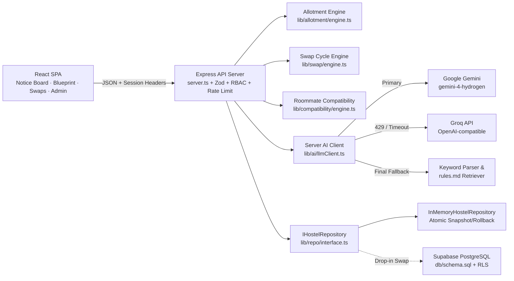

# HostelHub — University Hostel Allotment & Room Exchange Platform

HostelHub is a full-stack university hostel management platform designed to solve three recurring campus challenges:

1. **Explainable Room Allotment** — deterministic, seed-reproducible allocation honoring capacity, block gender policies, ranked preferences, and mutual roommate requests.
2. **Multi-Way Room Exchange** — directed-graph cycle detection supporting atomic 2-way, 3-way, and 4-way room swaps only when 100% of participants explicitly consent.
3. **Transparent Warden Administration** — side-by-side allotment run comparisons, live interactive floor blueprints, dispute tracking, immutable audit logs, and a grounded hostel rules desk.

---

## Main Features

- **Student Workspace (`/student`, `/student/profile`, `/student/allotment`)**: Profile and living-habit editor, up to 5 ranked room preferences with reordering, formal allotment slip with plain-English explanation (or unallotted reason), and Warden dispute logging.
- **Interactive Floor Blueprints (`/rooms`)**: Hand-drawn SVG floor plans driven by real occupancy data, brass room key tags, structural filters, and server-side natural-language room search with deterministic keyword fallback.
- **Multi-Way Swap Notice Board (`/swaps`)**: Pin room-exchange chits, discover valid 2/3/4-way cycles via bounded DFS, inspect SVG-connected consent cards, and atomically execute swaps upon unanimous acceptance with 72-hour expiry enforcement.
- **Roommate Finder (`/roommates`)**: Deterministic rule-based 0–100 compatibility scoring (sleep schedule, study style, cleanliness, cached optional bio overlap) with mutual roommate requests.
- **Hostel Policy Desk (`/assistant`)**: Conversational Q&A grounded strictly in `rules.md`. Unsupported policy questions explicitly respond: `"I don't know the exact rule. Please contact the warden."`
- **Warden Office (`/admin`)**: Allotment weight tuning, seeded runs, side-by-side run comparison, room inventory management, student register, dispute resolution, live occupancy analytics, immutable audit logs, and live `rules.md` editing.

---

## Technology Stack

- **Frontend**: React 19, TypeScript (strict mode), Tailwind CSS v4, Lucide icons (monochrome affordances).
- **Backend**: Express TypeScript server (`server.ts`) mounting Vite middleware in dev and static `dist/` in production, Zod request/response validation, sliding-window rate limiting, server-side RBAC.
- **Data Access**: Repository pattern (`lib/repo/interface.ts`) with `InMemoryHostelRepository` + production PostgreSQL/Supabase schema (`db/schema.sql`) including constraints, indexes, and Row Level Security (RLS) policies.
- **AI Layer**: Server-side `HostelLlmClient` (`lib/ai/llmClient.ts`) using Google Gemini (`@google/genai`, `gemini-4-hydrogen`) as primary, Groq OpenAI-compatible API as automatic fallback on HTTP 429/timeout, normalized query caching, single retry on invalid JSON, and deterministic offline fallback.
- **Testing**: Vitest unit test suites covering allotment invariants, swap cycle atomicity, AI fallback resilience, roommate scoring, and Zod/RBAC validation.

---

## Architecture



---

## Database Structure

`db/schema.sql` defines normalized relational tables with primary keys, foreign keys, `CHECK` constraints, GIN/B-tree indexes, and Supabase RLS policies:

- `blocks`, `rooms`, `students` (with `@univ.edu.in` email constraint)
- `student_preferences` (enforcing `rank between 1 and 5` and unique `(student_id, room_id)`)
- `roommate_requests` (enforcing `requester_id <> target_id`)
- `allotment_runs`, `allotment_results`
- `swap_requests` (partial unique index limiting one active request per student), `swap_proposals`
- `disputes`, `announcements`, `audit_logs`

---

## Allotment Algorithm Explanation

Located in `lib/allotment/engine.ts`.

### Why Deterministic Algorithms Instead of LLMs?
Hostel allotment affects student living conditions and is frequently audited or disputed. LLMs are probabilistic, non-reproducible, prone to constraint violations (overfilling rooms or violating gender rules), and cannot mathematically explain why Student A received Room 204 over Student B. HostelHub uses a pure deterministic TypeScript engine where any administrator or auditor can re-run the exact same `(seed, rules, preferences)` and verify identical outputs.

### Algorithm Steps & Complexity
1. **Priority Scoring**: `year * year_weight + (enable_merit_band ? merit_score * merit_weight : 0)` plus a deterministic FNV-1a/Mulberry32 tie-breaker hashed from `${seed}::${student.id}` (so input array order never changes results). Complexity: `O(N log N)`.
2. **Serial Dictatorship Pass**: Processes students in descending priority order, assigning each to their highest-ranked gender-eligible room with available capacity. When `preserve_mutual_roommates` is enabled, mutual pairs are co-allotted into a shared preferred room with `>= 2` open slots when feasible. Complexity: `O(N * P)` where `P <= 5`.
3. **Pareto-Improving Exchange Pass**: Scans allotted same-gender pairs and executes swaps only when at least one student strictly improves their preference rank and neither student is made worse off.

### Fairness & Strategy-Proofness Trade-offs
Pure Serial Dictatorship under strict individual preferences is Pareto-efficient and strategy-proof (truthful ranking is a dominant strategy). However, enabling mutual roommate coupling or post-hoc pairwise trades improves social satisfaction at the cost of breaking strict strategy-proofness in contrived edge cases. Both toggles are exposed explicitly in the Warden Office so policy trade-offs remain transparent.

---

## Swap Cycle Detection Explanation

Located in `lib/swap/engine.ts` and executed atomically in `lib/repo/memoryRepo.ts`.

- **Graph Model**: Each student with an open swap request is a vertex. A directed edge `u -> v` exists if student `u` is gender-eligible for student `v`'s current room and `v`'s room satisfies `u`'s wanted criteria.
- **Bounded Canonical DFS**: Searches for simple directed cycles of length `2, 3, 4`, anchored at the lexicographically smallest student ID so every cycle is discovered exactly once.
- **Vertex-Disjoint Proposal Locking**: Prevents concurrent conflicting proposals from double-booking the same student.
- **Atomic Execution**: Only once 100% of cycle participants explicitly accept (before the 72-hour expiry) does the repository snapshot affected records, verify live occupancy/capacity/gender invariants, commit all room moves together, or roll back completely on any failure. Every transition writes an entry to `AuditLog`.

---

## AI Architecture & Fallback Mechanism

Located in `lib/ai/llmClient.ts` and `lib/ai/rulesRetriever.ts`:

1. **Server-Side Only**: API keys (`GEMINI_API_KEY`, `GROQ_API_KEY`) never enter client bundles.
2. **Primary → Secondary → Offline Chain**: Calls Gemini (`gemini-4-hydrogen`) first; on HTTP 429 or timeout, automatically routes to Groq; if both fail or keys are absent, executes deterministic offline keyword parsing (for room search) or section-grounded excerpt answers from `rules.md`.
3. **Schema Validation & Retry**: Natural-language room search responses are validated with `NaturalLanguageRoomFilterSchema` (Zod); invalid JSON triggers exactly one retry before falling back.
4. **No AI Authority**: AI outputs are strictly advisory filters or policy explanations and can never bypass gender eligibility, run allotment, or execute swaps.

---

## Authentication, RBAC & Security Architecture

HostelHub enforces strict server-side authentication and three-role access control (`STUDENT`, `WARDEN`, `ADMIN`). **No public role switcher exists**—roles are never modifiable from the UI, browser console, URL, localStorage, or client headers.

### Roles & Permission Matrix

| Capability | `STUDENT` | `WARDEN` (Assigned Blocks Only) | `ADMIN` |
|---|---|---|---|
| Public Notice Board (`/`, `/api/overview`) | Read | Read | Read |
| Own Profile, Preferences & Allotment Slip (`/student/*`) | Read / Update | — | All Students |
| Room Blueprints & Swap Notice Board (`/rooms`, `/swaps`) | Read / Own Swaps | Assigned-Block Moderation | Full Control |
| Room Inventory Edits (`POST/PATCH /api/rooms`) | Denied (403) | Assigned Blocks Only (403 outside) | All Blocks |
| Complaints / Disputes (`PATCH /api/disputes/:id`) | Submit Own Only | Assigned-Block Residents Only | All Disputes |
| Hostel Notices (`POST /api/notices`) | Denied (403) | Assigned Blocks Only | Campus-Wide & Block |
| Allotment Rules, Runs & Publish (`/api/allotment/*`) | View Official Only | View Official Only | Full Control |
| Account Provisioning, Roles, MFA & Security Settings (`/api/admin/*`) | Denied (403) | Denied (403) | Full Control (No Self-Role Edit) |

### Key Security Safeguards
- **Portal Role Verification**: `/login` offers Student, Warden, and Admin login portals. Portal selection only configures the sign-in flow; the server verifies the authenticated user's actual stored role and denies mismatches with a generic non-enumerating error (`"Invalid credentials or unauthorized portal access."`).
- **Server-Side Sessions & CSRF**: Sessions use 256-bit HMAC-SHA256 signed opaque IDs stored server-side and delivered via `HttpOnly` cookies (`Secure; SameSite=None; Partitioned` over HTTPS). All state-changing API routes require CSRF validation (`Origin` match or `X-Requested-With: HostelHub`).
- **Password Hashing, Lockout & Admin MFA**: Passwords are salted and hashed with `scrypt` (`crypto.timingSafeEqual`). Login attempts lock after repeated failures; Admin accounts support RFC 6238 TOTP Multi-Factor Authentication.
- **Database & RLS (`db/schema.sql`)**: Defines `public.profiles`, `public.warden_assignments`, `public.admin_audit_logs`, a PostgreSQL trigger blocking ordinary profile updates from altering `role` or `status`, and 3-role Supabase Row Level Security policies.
- **No Public Staff Registration**: `/register` strictly creates verified `STUDENT` accounts. Warden and Admin accounts can only be provisioned by an existing authenticated `ADMIN` via `/api/admin/accounts/provision`.

---

## Visual Design Decisions ("The Warden's Notice Board")

HostelHub avoids generic SaaS templates in favor of a restrained Indian university hostel aesthetic:

- **Palette**: Warm paper (`#F1E6CF`), deep register ink (`#1F2A5A`, never pure black), stamp red (`#B3261E`), chalk yellow (`#F2C94C`), light chalk (`#FBE9A6`), wall green (`#5E8C6A`), and brick (`#C2552D`).
- **Typography**: `Yatra One` for selective hostel signage, `Mukta` for body prose and forms, `Kalam` strictly for short handwritten margin instructions, and `Courier Prime` with tabular numerals for room numbers, IDs, and ledgers.
- **Tactile Restraint**: Hard offset ink shadows (`4px 4px 0 #1F2A5A`), square 0–2px corners, architectural blueprint SVG maps, brass key tags, deterministic ID-based chit tilt, and rubber stamps reserved exclusively for verified states.

---

## Getting Started

### Installation

```bash
npm install
```

### Environment Variables & Demo Accounts (No Hardcoded Passwords)

Copy `.env.example` to `.env`:

```env
GEMINI_API_KEY=""
GROQ_API_KEY=""
APP_URL="http://localhost:3000"
ALLOWED_EMAIL_DOMAIN="univ.edu.in"
SESSION_SECRET=""

# Optional: Pre-configure local demo passwords (never commit real passwords)
DEMO_ADMIN_PASSWORD=""
DEMO_WARDEN_PASSWORD=""
DEMO_STUDENT_PASSWORD=""
```

**Pre-seeded synthetic campus accounts:**
- **Admin**: `admin.demo@hostelhub.local`
- **Warden** *(assigned strictly to Nilgiri & Kaveri Bhavans)*: `warden.demo@hostelhub.local`
- **Student**: `student.demo@hostelhub.local` (or Student ID `VV2024CO101`)

If `DEMO_*_PASSWORD` environment variables are not set, `/login` automatically presents a **one-time Initial Campus Setup** form so you can choose your own passwords on first launch. Once submitted, `/api/auth/bootstrap` locks permanently.

### Run Development Server

```bash
npm run dev
```

### Seed Summary, Large-Scale Simulation & Tests

```bash
# Inspect synthetic seed dataset (300 students, 4 blocks, 120 rooms)
npm run seed

# Run 1,200-student performance benchmark
npm run simulate

# Run Vitest unit & HTTP RBAC test suites
npm test

# Type-check strict TypeScript & production build
npm run lint
npm run build
```

---

## Free-Tier Deployment

HostelHub runs completely on free-tier infrastructure:
- **Compute**: Render / Fly.io / Google Cloud Run (`npm run build && npm start`).
- **Database & Auth**: Supabase Free Tier using `db/schema.sql` (`profiles`, `warden_assignments`, `admin_audit_logs`, and 3-role RLS policies).
- **AI**: Google AI Studio Gemini free tier + Groq free tier fallback + zero-cost deterministic offline mode.

---

## Known Limitations & Future Improvements

- **In-Memory Persistence**: Data resets on server restart until `IHostelRepository` and `HostelAuthService` are backed by Supabase PostgreSQL using `db/schema.sql`.
- **SMTP Delivery**: In local development without an SMTP provider, email verification and password reset tokens are surfaced in the local preview response; production deployments should wire Supabase Auth or an SMTP provider to deliver tokens exclusively via email.
- **Future Improvements**: PDF export of signed allotment slips, WebSocket live notifications when a swap cycle reaches unanimous consent, and multi-round waitlist carry-over.

